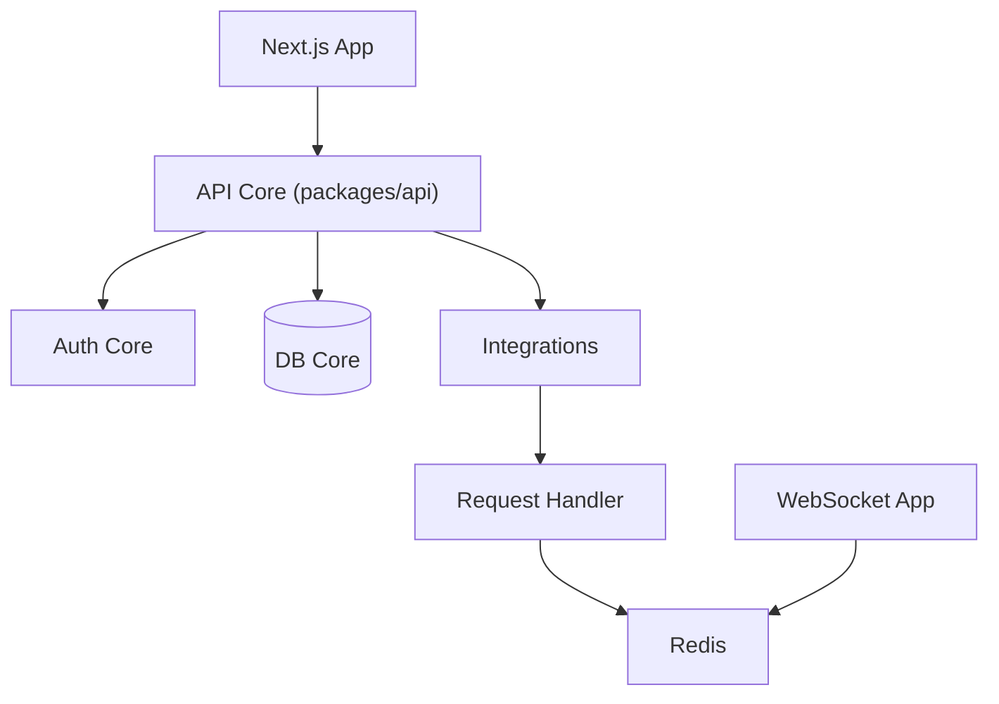

# homarr-labs/homarr

> Customizable self-hosted dashboard to group your homelab applications, with widgets and integrations.

## The problem
Finding and monitoring from a single place the many self-hosted applications of a personal server.

## What it actually does
Homarr displays boards that can be arranged by drag and drop, with widgets fed by integrations (Docker, Kubernetes, media managers, home automation, DNS…). It handles users, groups, permissions, SSO via OIDC or LDAP, built-in search and a picker of more than 11,000 icons. Real-time updates go through WebSockets, tRPC and Redis; the database can be SQLite, MySQL or PostgreSQL.

## How it is wired

## Trying it
No command documented in the README: it points to the official installation instructions.

## Cost and gotchas
Free, funded by donations (OpenCollective). The full deployment involves several processes (web app, WebSocket, tasks) and Redis. Secrets are encrypted with AES-256-CBC according to the README.

## What it is not
Not a tool for monitoring models or data pipelines: it is a portal of links and widgets for homelabs.

## Alternatives
No alternative cited in the README.

## For you
Ignore: consumer homelab product, no use for a data / AI / MLOps profile, unless you run a personal server.
