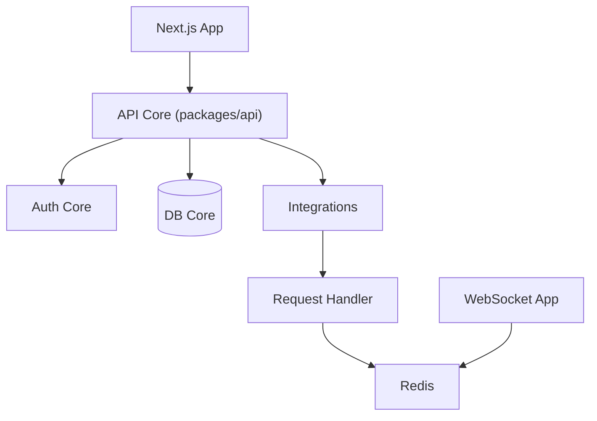

# homarr-labs/homarr

> Tableau de bord auto-hébergé personnalisable pour regrouper ses applications de homelab, avec widgets et intégrations.

## Le problème
Retrouver et surveiller d'un seul endroit les nombreuses applications auto-hébergées d'un serveur personnel.

## Ce que ça fait vraiment
Homarr affiche des tableaux modulables par glisser-déposer, avec widgets alimentés par des intégrations (Docker, Kubernetes, gestionnaires de médias, domotique, DNS…). Il gère utilisateurs, groupes, permissions, SSO via OIDC ou LDAP, une recherche intégrée et un sélecteur de plus de 11 000 icônes. Les mises à jour en temps réel passent par WebSockets, tRPC et Redis ; la base peut être SQLite, MySQL ou PostgreSQL.

## Comment c'est branché

## Essayer
Aucune commande documentée dans le README : il renvoie aux instructions d'installation officielles.

## Coût et pièges
Gratuit, financé par dons (OpenCollective). Le déploiement complet fait intervenir plusieurs processus (application web, WebSocket, tâches) et Redis. Les secrets sont chiffrés en AES-256-CBC selon le README.

## Ce que ce n'est pas
Pas un outil de supervision de modèles ni de pipelines de données : c'est un portail de liens et de widgets pour homelab.

## Alternatives
Aucune alternative citée dans le README.

## Pour toi
À ignorer : produit grand public de homelab, sans usage pour un profil data / IA / MLOps, sauf si tu gères un serveur personnel.

