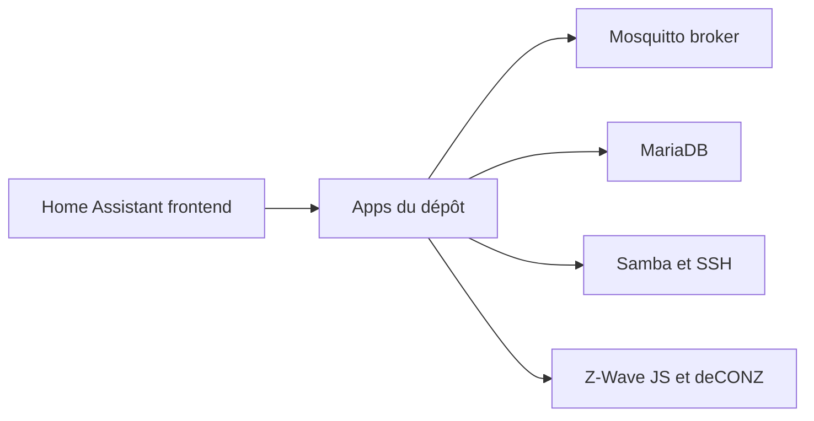

# home-assistant/addons

> Official repository of apps (formerly add-ons) for Home Assistant: MQTT, Samba, SSH, Z-Wave JS, etc.

## The problem
Extending a Home Assistant with an MQTT broker, a database or access to the configuration requires installing and maintaining these services separately.

## What it actually does
Provides about fifteen apps installable from the Home Assistant interface: CEC Scanner, deCONZ, Dnsmasq, Duck DNS, File editor, Git pull, Let's Encrypt, MariaDB, Mosquitto, NGINX SSL proxy, RPC Shutdown, Samba, SSH server, Z-Wave JS. Also serves as a template for developing your own apps.

## How it is wired

(Diagram built from the README; no code graph provided.)

## Trying it
No command in the README: installation is done from the Home Assistant interface.

## Cost and gotchas
Free. Assumes a Home Assistant system with a supervisor; some apps require hardware (Zigbee dongle, USB Z-Wave controller).

## What it is not
Not a standalone application: unusable without Home Assistant.

## Alternatives
None named in the README.

## For you
Ignore: home automation, unrelated to data/AI/MLOps; only the MQTT broker and MariaDB could be useful for a home project.
