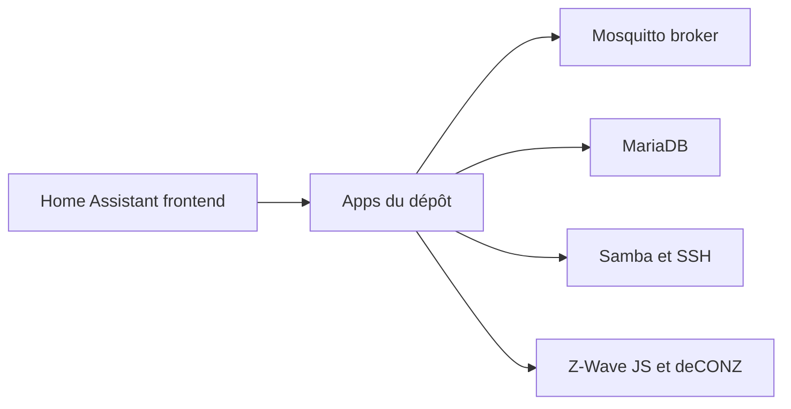

# home-assistant/addons

> Dépôt officiel des apps (ex add-ons) pour Home Assistant : MQTT, Samba, SSH, Z-Wave JS, etc.

## Le problème
Étendre un Home Assistant avec un broker MQTT, une base de données ou un accès à la configuration demande d'installer et d'entretenir ces services à part.

## Ce que ça fait vraiment
Fournit une quinzaine d'apps installables depuis l'interface Home Assistant : CEC Scanner, deCONZ, Dnsmasq, Duck DNS, File editor, Git pull, Let's Encrypt, MariaDB, Mosquitto, proxy SSL NGINX, RPC Shutdown, Samba, serveur SSH, Z-Wave JS. Sert aussi de modèle pour développer ses propres apps.

## Comment c'est branché

(Schéma établi d'après le README ; pas de graphe de code fourni.)

## Essayer
Aucune commande dans le README : l'installation se fait depuis l'interface Home Assistant.

## Coût et pièges
Gratuit. Suppose un système Home Assistant avec superviseur ; certaines apps exigent du matériel (clé Zigbee, contrôleur Z-Wave USB).

## Ce que ce n'est pas
Pas une application autonome : inutilisable sans Home Assistant.

## Alternatives
Aucune nommée dans le README.

## Pour toi
Ignorer : domotique, sans lien avec data/IA/MLOps ; seul le broker MQTT et MariaDB pourraient servir à un projet maison.

