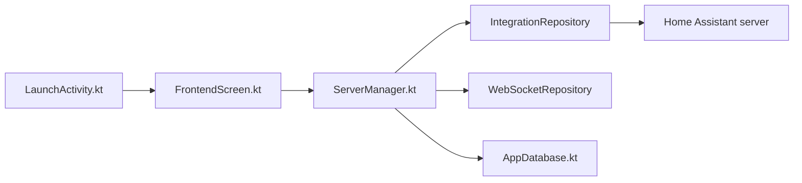

# home-assistant/android

> Official Home Assistant Android app: sensors, notifications, widgets, Wear OS and car.

## The problem
A Home Assistant server is hard to control from a phone without a native client.

## What it actually does
A Compose shell around the Home Assistant web interface, linked to native capabilities: sensors, FCM notifications, Android controls, widgets, Assist voice with a TensorFlow Lite wake-word (JNI/C++), NFC, Matter/Thread. Three Gradle apps (handset, Wear OS, automotive) built around a `common` module.

## How it is wired

## Trying it
No command: install via the Play Store or other stores, developer guide online.

## Cost and gotchas
Free, but you need a Home Assistant instance. The full variant uses Google Play Services and Firebase.

## What it is not
Not a home automation server: only the client. It does not work on its own.

## Alternatives
No alternative named in the README.

## For you
Ignore: useful only if you have a Home Assistant setup; outside the data/AI scope.
