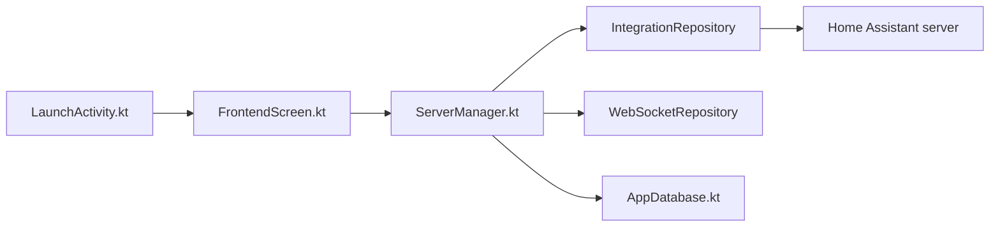

# home-assistant/android

> Application Android officielle de Home Assistant : sensors, notifications, widgets, Wear OS et voiture.

## Le problème
Un serveur Home Assistant ne se contrôle pas bien depuis un téléphone sans client natif.

## Ce que ça fait vraiment
Coque Compose autour de l'interface web Home Assistant, reliée à des capacités natives : sensors, notifications FCM, contrôles Android, widgets, Assist vocal avec wake-word TensorFlow Lite (JNI/C++), NFC, Matter/Thread. Trois applications Gradle (handset, Wear OS, automotive) autour d'un module `common`.

## Comment c'est branché

## Essayer
Aucune commande : installation via le Play Store ou d'autres stores, guide développeur en ligne.

## Coût et pièges
Gratuit, mais il faut une instance Home Assistant. La variante complète utilise Google Play Services et Firebase.

## Ce que ce n'est pas
Pas un serveur domotique : seulement le client. Ne fonctionne pas seul.

## Alternatives
Aucune alternative nommée dans le README.

## Pour toi
Ignorer : utile seulement si tu as une domotique Home Assistant ; hors périmètre data/IA.

