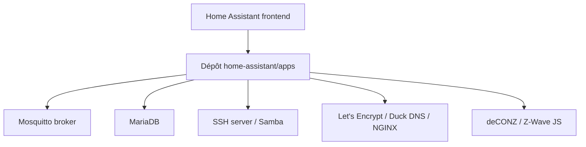

# home-assistant/apps

> Official repository of extensions (apps) for Home Assistant: MQTT, database, SSH, certificates.

## The problem
Home Assistant alone does not provide the ancillary services (MQTT broker, MariaDB database, Samba sharing, certificates) that often need to be added to a home automation installation.

## What it actually does
Offers fifteen apps installable from the Home Assistant interface: CEC Scanner, deCONZ, Dnsmasq, Duck DNS, File editor, Git pull, Let's Encrypt, MariaDB, Mosquitto, NGINX SSL proxy, RPC Shutdown, Samba, SSH server, Voice Support, Z-Wave JS. Also serves as a template for writing your own apps.

## How it is wired
Simplified diagram based on the sheet, no diagram provided.

## Trying it
No command documented in the README: apps are installed and configured from the Home Assistant interface.

## Cost and gotchas
Free. Requires a Home Assistant installation that manages apps. Some apps require hardware (ConBee or RaspBee dongle, or USB Z-Wave controller).

## What it is not
Not a standalone application: useless without Home Assistant. Neither a SaaS nor a data tool.

## Alternatives
No alternative named in the README.

## For you
Ignore for a data/AI/MLOps profile unless you run home automation at home: the repository is solid but outside your scope.
