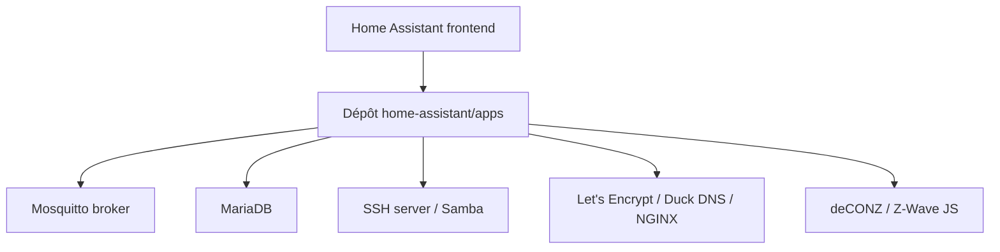

# home-assistant/apps

> Dépôt officiel d'extensions (apps) pour Home Assistant : MQTT, base de données, SSH, certificats.

## Le problème
Home Assistant seul ne fournit pas les services annexes (broker MQTT, base MariaDB, partage Samba, certificats) qu'il faut souvent ajouter à une installation domotique.

## Ce que ça fait vraiment
Propose quinze apps installables depuis l'interface de Home Assistant : CEC Scanner, deCONZ, Dnsmasq, Duck DNS, File editor, Git pull, Let's Encrypt, MariaDB, Mosquitto, proxy SSL NGINX, RPC Shutdown, Samba, serveur SSH, Voice Support, Z-Wave JS. Sert aussi de modèle pour écrire ses propres apps.

## Comment c'est branché
Schéma simplifié d'après la fiche, sans diagramme fourni.

## Essayer
Aucune commande documentée dans le README : les apps s'installent et se configurent depuis l'interface de Home Assistant.

## Coût et pièges
Gratuit. Requiert une installation de Home Assistant qui gère les apps. Certaines apps demandent du matériel (clé ConBee, RaspBee ou contrôleur USB Z-Wave).

## Ce que ce n'est pas
Pas une application autonome : inutile sans Home Assistant. Ni un SaaS ni un outil de données.

## Alternatives
Aucune alternative nommée dans le README.

## Pour toi
À ignorer pour un profil data/IA/MLOps sauf si tu gères une domotique chez toi : le dépôt est solide mais hors de ton périmètre.

