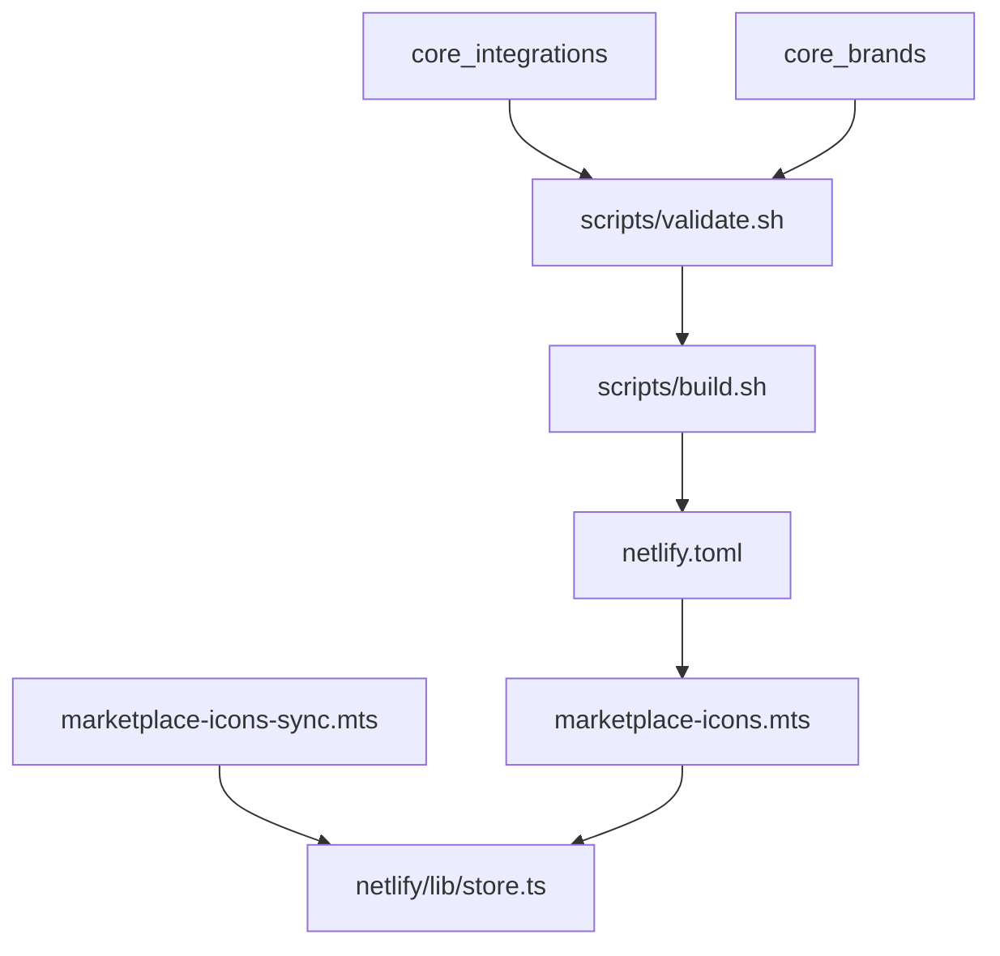

# home-assistant/brands

> Repository of Home Assistant integration icons and logos, served as a static site for its projects.

## The problem
Home Assistant projects need a central place for their integrations' brand images.

## What it actually does
Images are organized by integration domain (`core_integrations`, `custom_integrations`, `thread_brands`) with up to eight variants per domain (icon, logo, dark, hDPI). A static site serves them at `brands.home-assistant.io`, with or without a fallback image. Netlify functions synchronize and serve the Marketplace icons.

## How it is wired


## Trying it
```bash
npm test
npm run check
node scripts/marketplace-icons-sync.ts index.json
```

## Cost and gotchas
Free. The commands above require Node.js (see `.nvmrc`); a `GITHUB_TOKEN` is optional. License not declared on GitHub, and the images remain the property of their brands.

## What it is not
Not a library to install: you consume the URLs. The brand images are not royalty-free; they are for identification only.

## Alternatives
No alternative named in the README.

## For you
Ignore: useful only if you contribute to Home Assistant, nothing for a data / AI profile.
