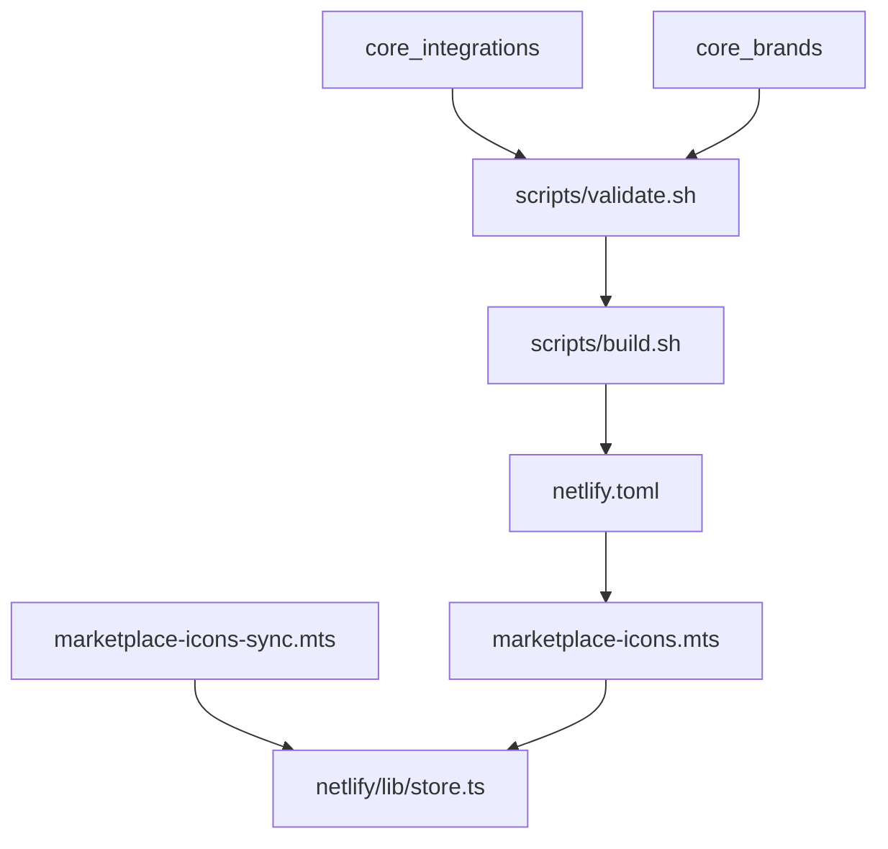

# home-assistant/brands

> Dépôt des icônes et logos des intégrations Home Assistant, servis en site statique pour ses projets.

## Le problème
Les projets Home Assistant ont besoin d'un endroit central pour les images de marque de leurs intégrations.

## Ce que ça fait vraiment
Les images sont rangées par domaine d'intégration (`core_integrations`, `custom_integrations`, `thread_brands`) avec jusqu'à huit variantes par domaine (icône, logo, sombre, hDPI). Un site statique les sert sur `brands.home-assistant.io`, avec ou sans image de remplacement. Des fonctions Netlify synchronisent et servent les icônes du Marketplace.

## Comment c'est branché


## Essayer
```bash
npm test
npm run check
node scripts/marketplace-icons-sync.ts index.json
```

## Coût et pièges
Gratuit. Les commandes ci-dessus demandent Node.js (voir `.nvmrc`) ; un jeton `GITHUB_TOKEN` est facultatif. Licence non déclarée sur GitHub, et les images restent la propriété de leurs marques.

## Ce que ce n'est pas
Ce n'est pas une bibliothèque à installer : on consomme les URL. Les images de marque ne sont pas libres de droits, elles servent à l'identification seulement.

## Alternatives
Aucune alternative nommée dans le README.

## Pour toi
À ignorer : utile seulement si tu contribues à Home Assistant, rien pour un profil data / IA.

