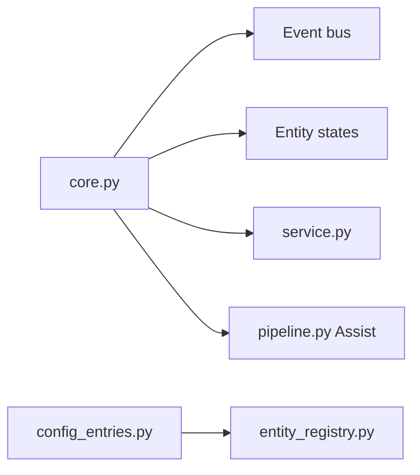

# home-assistant/core

> Open-source home automation platform for Raspberry Pi or server, with a focus on privacy.

## The problem
Connected devices rely on their respective cloud and application.

## What it actually does
A core manages an event bus and the state of entities. Configurable integrations, exposed through entity and device registries, provide services, persistent storage, and authentication. It also includes Assist (a voice pipeline: recognition, conversation, and synthesis) and backup and restore functionality. The README provides instructions for installation on the target site.

## How it is wired


## Trying it
```bash
# aucune commande dans le README : voir home-assistant.io
```

## Cost and gotchas
Free. You are responsible for providing the smart home equipment and local machine. Project of the Open Home Foundation.

## What it is not
This is not a data or machine learning tool. The README is very basic and refers to other pages.

## Alternatives
No alternative is specified in the README file.

## For you
Do not use for anything other than domestic purposes: no connection to a data pipeline or MLOps.
