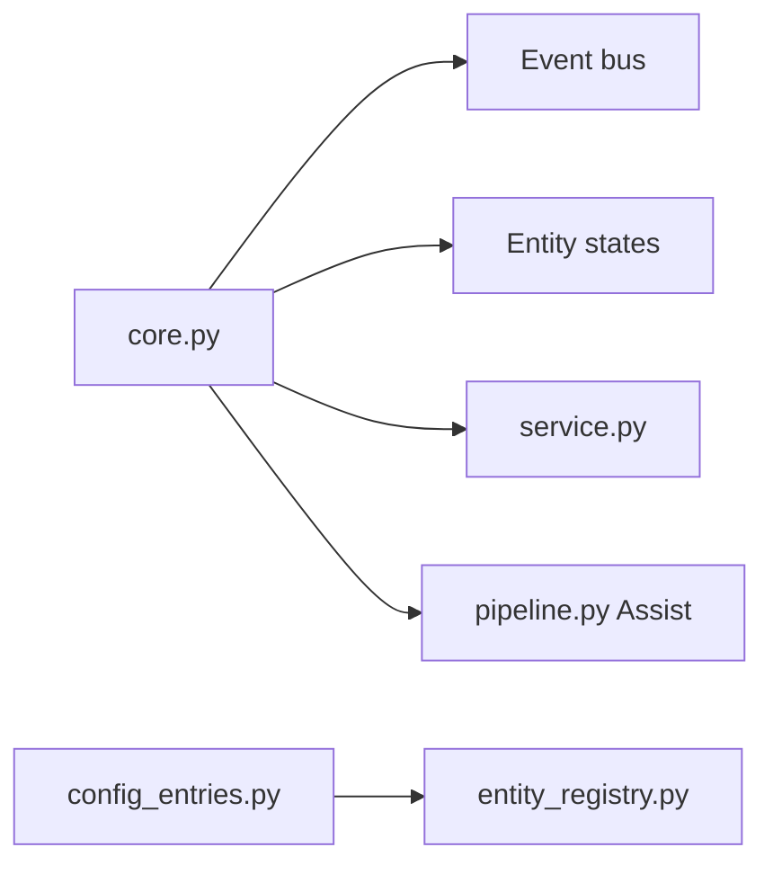

# home-assistant/core

> Plateforme libre de domotique locale, respectueuse de la vie privée, pour Raspberry Pi ou serveur.

## Le problème
Les objets connectés dépendent chacun de leur cloud et de leur application.

## Ce que ça fait vraiment
Un noyau gère un bus d'événements et les états des entités. Des intégrations configurées par flux exposent les appareils via des registres d'entités et d'appareils, avec services, stockage persistant et authentification. Il ajoute Assist (pipeline vocal : reconnaissance, conversation, synthèse) et sauvegarde et restauration. Le README renvoie l'installation au site.

## Comment c'est branché


## Essayer
```bash
# aucune commande dans le README : voir home-assistant.io
```

## Coût et pièges
Gratuit. Matériel domotique et machine locale à ta charge. Projet de l'Open Home Foundation.

## Ce que ce n'est pas
Pas un outil de données ou de ML. Le README est mince et renvoie à d'autres pages.

## Alternatives
Aucune alternative nommée dans le README.

## Pour toi
À ignorer sauf usage domestique : pas de lien avec un pipeline data ou MLOps.

