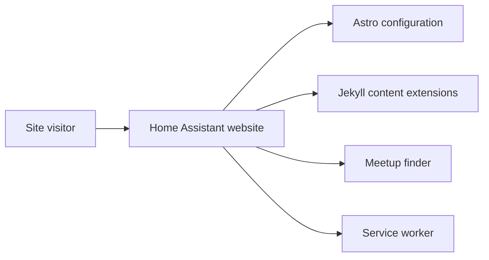

# home-assistant/home-assistant.io

> Source code of the Home Assistant website and documentation, for contributors.

## The problem
Maintaining the documentation of a home automation project, with product pages and community tools.

## What it actually does
Jekyll site with extensions (example blocks, templates), a migration to Astro in progress, a meetup finder, a community image generator, an animated ZWA-2 page and a service worker. The `current`, `rc` and `next` branches feed production, beta and development.

## How it is wired


## Trying it
```bash
bundle exec rake preview
bundle exec rake isolate[filename-of-blogpost]
bundle exec rake integrate
```

## Cost and gotchas
Free. Generation is slow because of the long release logs; the `isolate` command isolates blog posts.

## What it is not
Not the Home Assistant software itself: only its website. License "unidentified" in the catalog.

## Alternatives
No alternative named in the README.

## For you
Ignore: source of a documentation site, useful only if you contribute to the Home Assistant docs.
