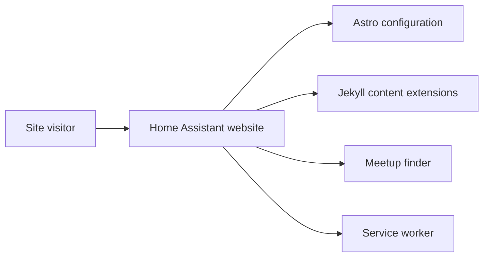

# home-assistant/home-assistant.io

> Code source du site web et de la documentation de Home Assistant, pour contributeurs.

## Le problème
Maintenir la documentation d'un projet domotique avec des pages produit et des outils communautaires.

## Ce que ça fait vraiment
Site Jekyll avec extensions (blocs d'exemples, modèles), une migration vers Astro en cours, un chercheur de meetups, un générateur d'images communautaires, une page animée ZWA-2 et un service worker. Les branches `current`, `rc` et `next` alimentent production, bêta et développement.

## Comment c'est branché


## Essayer
```bash
bundle exec rake preview
bundle exec rake isolate[filename-of-blogpost]
bundle exec rake integrate
```

## Coût et pièges
Gratuit. La génération est lente à cause des longs journaux de versions ; la commande `isolate` isole les billets.

## Ce que ce n'est pas
Pas le logiciel Home Assistant lui-même : seulement son site. Licence « non identifiée » au catalogue.

## Alternatives
Aucune alternative nommée dans le README.

## Pour toi
À ignorer : source d'un site de documentation, utile seulement si tu contribues à la doc de Home Assistant.

