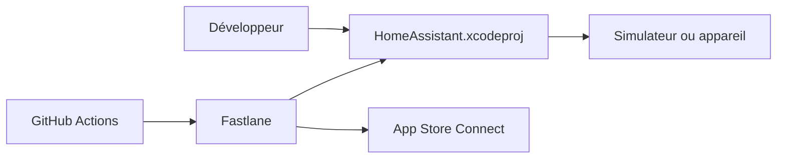

# home-assistant/iOS

> Official Home Assistant app for iPhone, iPad and Mac, with build instructions for contributors.

## The problem
Controlling your Home Assistant home automation from Apple devices requires a native app with entitlements, notifications and integrations.

## What it actually does
The README does not describe the app's features: it mostly explains how to build it (Xcode 27 beta, Bundler/Fastlane), test the interface through a simulator build produced by GitHub Actions, configure code signing, run the linters (SwiftFormat, SwiftLint, Rubocop, YamlLint) and deploy to App Store Connect.

## How it is wired


## Trying it
```bash
git clone https://github.com/home-assistant/iOS.git
cd iOS
brew install rbenv ruby-build
rbenv install
bundle install
bundle exec fastlane lint
bundle exec fastlane ios build
```

## Cost and gotchas
Free on the code side, but you need an Apple developer account and a `DEVELOPMENT_TEAM` in `Configuration/HomeAssistant.overrides.xcconfig`, because the app uses entitlements even in the simulator. Xcode required: 27.0 (beta).

## What it is not
Not the Home Assistant server: it is only the Apple client. The app's finer features are not documented here.

## Alternatives
None named in the README.

## For you
Ignore: a mobile home automation client unrelated to data/AI/MLOps.
