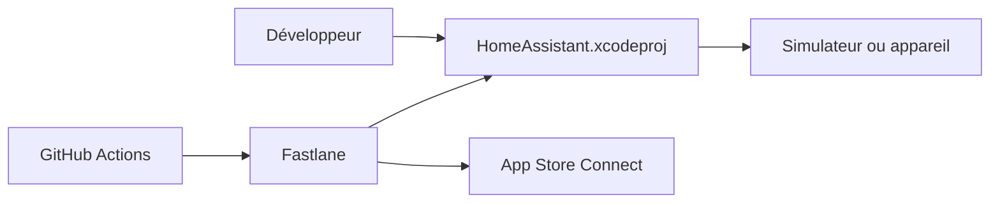

# home-assistant/iOS

> Application officielle Home Assistant pour iPhone, iPad et Mac, avec instructions de build pour contributeurs.

## Le problème
Piloter sa domotique Home Assistant depuis les appareils Apple demande une application native avec entitlements, notifications et intégrations.

## Ce que ça fait vraiment
Le README ne décrit pas les fonctions de l'application : il explique surtout comment la compiler (Xcode 27 bêta, Bundler/Fastlane), tester l'interface via un build de simulateur issu de GitHub Actions, configurer la signature de code, lancer les linters (SwiftFormat, SwiftLint, Rubocop, YamlLint) et déployer vers App Store Connect.

## Comment c'est branché


## Essayer
```bash
git clone https://github.com/home-assistant/iOS.git
cd iOS
brew install rbenv ruby-build
rbenv install
bundle install
bundle exec fastlane lint
bundle exec fastlane ios build
```

## Coût et pièges
Gratuit côté code, mais il faut un compte développeur Apple et un `DEVELOPMENT_TEAM` dans `Configuration/HomeAssistant.overrides.xcconfig`, car l'app utilise des entitlements même en simulateur. Xcode demandé : 27.0 (bêta).

## Ce que ce n'est pas
Pas le serveur Home Assistant : c'est seulement le client Apple. Les fonctions fines de l'app ne sont pas documentées ici.

## Alternatives
Aucune nommée dans le README.

## Pour toi
Ignorer : client mobile de domotique sans lien avec data/IA/MLOps.

