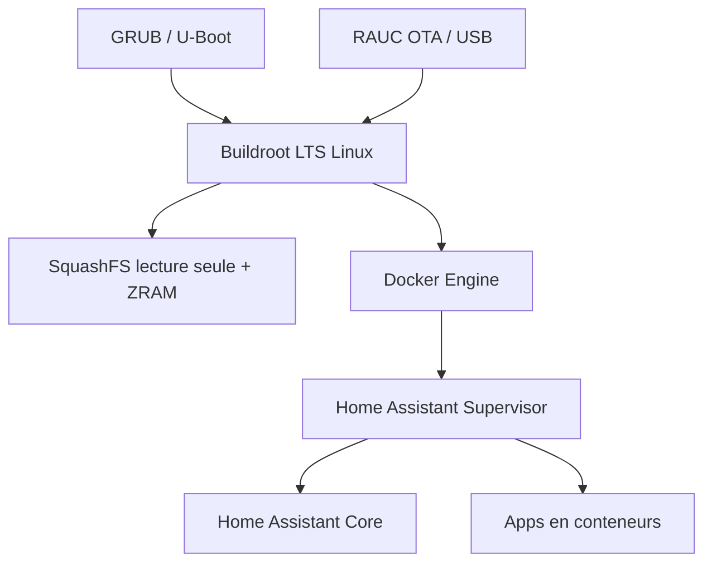

# home-assistant/operating-system

> Minimal Linux system built on Buildroot, dedicated to hosting Home Assistant.

## The problem
Installing Home Assistant on a general-purpose distribution brings useless packages, SD card wear from writes, and system updates that break the installation.

## What it actually does
An OS built with Buildroot, so not derived from Ubuntu or a classic distribution, targeting boards like the Raspberry Pi or ODROID, plus x86-64 UEFI. Docker serves as the container engine: the OS starts the Home Assistant Supervisor, which in turn drives the core and the apps in separate containers. Read-only SquashFS filesystems compressed with LZ4, ZRAM for `/tmp`, `/var` and swap, which limits writes. OTA and USB updates via RAUC, AppArmor hardening, GRUB or U-Boot depending on UEFI support.

## How it is wired


## Trying it
```bash
# Aucune commande documentée dans le README : il renvoie au guide d'installation
# officiel et aux builds de développement sur os-artifacts.home-assistant.io.
```

## Cost and gotchas
Free. The README warns: without experience in embedded systems, Buildroot or building Linux distributions, it is better to get trained first. Development builds are triggered manually by a GitHub Actions workflow — they are not stable releases.

## What it is not
It is not a general-purpose distribution: you do not install your own packages on it as you would elsewhere. It is not Home Assistant itself — only the base that hosts it.

## Alternatives
No alternative named in the README.

## For you
Personal home automation only; nothing to do with data or MLOps use.
