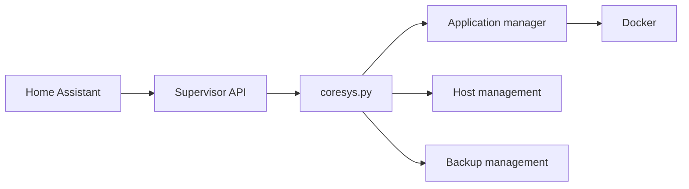

# home-assistant/supervisor

> Containerized control plane of Home Assistant OS, which manages apps, network, backups and updates.

## The problem
Running Home Assistant Core with its add-ons, its updates and its host requires an orchestration layer.

## What it actually does
Exposes an API driven by Home Assistant: installing and updating apps in Docker containers, network settings, hardware, OS, backups, mounts, service discovery, troubleshooting. Releases in dev, beta, stable channels. The README gives no further detail; installation goes through the Home Assistant website.

## How it is wired

## Trying it
No command documented in the README; installation instructions at home-assistant.io/getting-started and development instructions at developers.home-assistant.io.

## Cost and gotchas
Free, but designed to be installed through Home Assistant OS rather than by hand.

## What it is not
Not a standalone application nor a library: an internal Home Assistant component, with no isolated use.

## Alternatives
No alternative named in the README.

## For you
Ignore for a data/AI profile: it is internal home-automation infrastructure, useful only if you contribute to Home Assistant.
