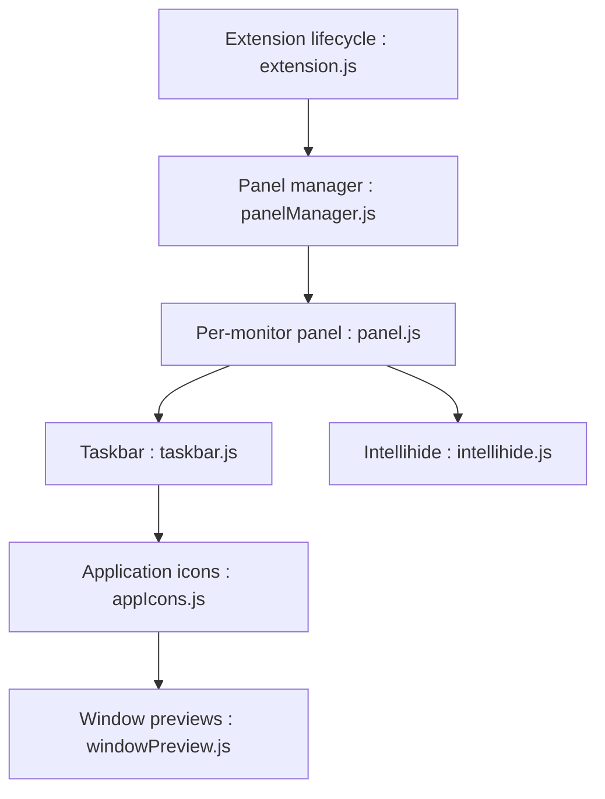

# home-sweet-gnome/dash-to-panel

> GNOME Shell extension that merges launchers and the system area into a single taskbar.

## The problem
The GNOME desktop separates the dock and the panel; some people prefer a single bar in the style of KDE or Windows.

## What it actually does
Moves the dash into the main panel: application icons, configurable running indicators, window previews on hover, launch by number, smart hiding, dynamic transparency, multi-monitor, settings export/import.

## How it is wired


## Trying it
```bash
dconf reset -f /org/gnome/shell/extensions/dash-to-panel/
```
Installation: from GNOME Extensions (the README points to the official page).

## Cost and gotchas
Free. Tested with GNOME 3.18+; recent GNOME versions may break extensions (not documented here). GPL-2.0 license.

## What it is not
Not a desktop environment, only a GNOME Shell extension.

## Alternatives
No alternative named in the README (it mentions complementary extensions such as Arc Menu).

## For you
Ignore: Linux desktop comfort unrelated to data/AI; install it only if you prefer a single bar.
