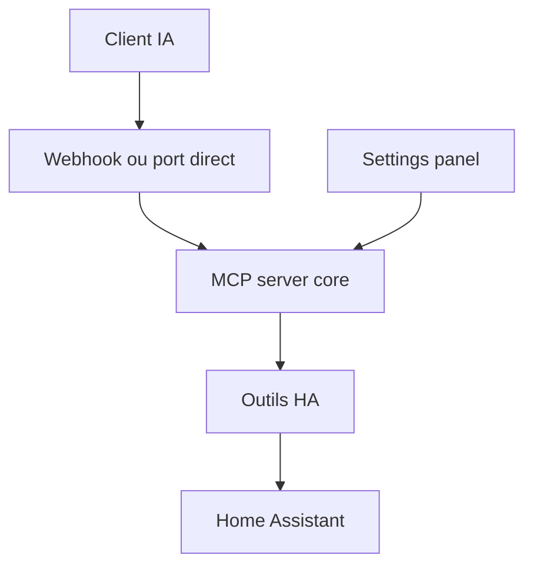

# homeassistant-ai/ha-mcp

> Unofficial MCP server that lets an AI assistant control and configure Home Assistant.

## The problem
The built-in MCP integration only sees entities exposed to Assist and does not allow creating or debugging automations.

## What it actually does
87 tools: entity search, service calls, automation creation, scripts, dashboards, history and traces, backups, device registry. Read-only mode, per-tool approval policies, automatic backups before edits. Recommended installation: a HACS component running the server inside Home Assistant.

## How it is wired


## Trying it
```bash
# HACS : ajouter https://github.com/homeassistant-ai/ha-mcp (catégorie Integration), redémarrer HA
# autre voie : uvx ha-mcp@latest ou image ghcr.io/homeassistant-ai/ha-mcp
```

## Cost and gotchas
A Home Assistant administrator token is required; only one installation mode per client (otherwise blockages). Stdio is discouraged.

## What it is not
Not the official Home Assistant MCP server. Broad permissions: enable read-only mode for unreliable agents.

## Alternatives
Home Assistant's built-in MCP server (control of entities exposed to Assist only).

## For you
Adopt if you have Home Assistant: a polished example of an MCP server with safeguards, with no telemetry today.
