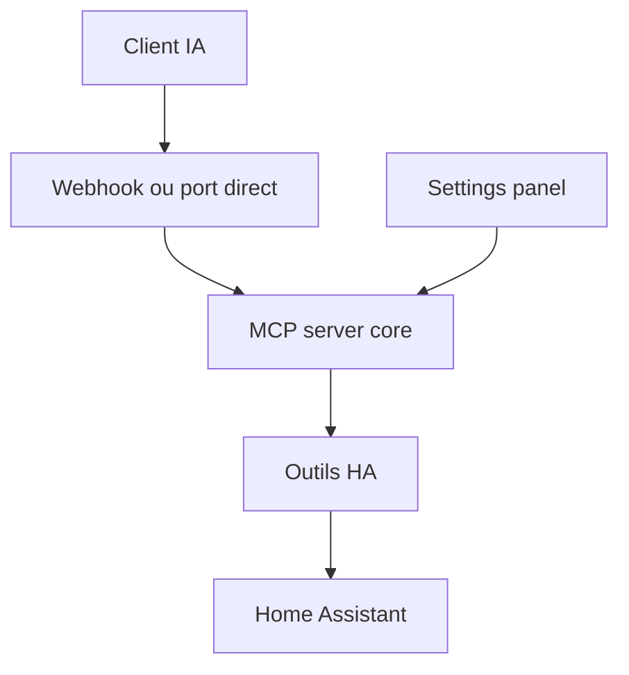

# homeassistant-ai/ha-mcp

> Serveur MCP non officiel qui laisse un assistant IA contrôler et configurer Home Assistant.

## Le problème
L'intégration MCP de base ne voit que les entités exposées à Assist et ne permet pas de créer ni déboguer des automatisations.

## Ce que ça fait vraiment
87 outils : recherche d'entités, appels de services, création d'automatisations, scripts, tableaux de bord, historique et traces, sauvegardes, registre d'appareils. Mode lecture seule, politiques d'approbation par outil, sauvegardes automatiques avant édition. Installation recommandée : composant HACS exécutant le serveur dans Home Assistant.

## Comment c'est branché


## Essayer
```bash
# HACS : ajouter https://github.com/homeassistant-ai/ha-mcp (catégorie Integration), redémarrer HA
# autre voie : uvx ha-mcp@latest ou image ghcr.io/homeassistant-ai/ha-mcp
```

## Coût et pièges
Jeton administrateur Home Assistant requis ; un seul mode d'installation par client (sinon blocages). Stdio déconseillé.

## Ce que ce n'est pas
Pas le serveur MCP officiel de Home Assistant. Droits larges : activer le mode lecture seule pour les agents peu fiables.

## Alternatives
Serveur MCP intégré de Home Assistant (contrôle d'entités exposées à Assist seulement).

## Pour toi
Adopter si tu as Home Assistant : exemple abouti de serveur MCP avec garde-fous, sans télémétrie aujourd'hui.

