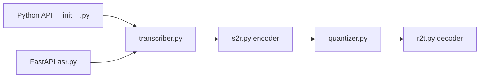

# homebrewltd/ichigo

> Inference package for transcribing speech and experimenting with an LLM that listens.

## The problem
Speech tasks (recognition, synthesis) rely on monolithic models that are hard to reuse.

## What it actually does
Provides Ichigo-ASR, a 22M-parameter speech tokenizer for Whisper-medium, usable in Python (`transcribe`) or through a FastAPI service (transcription, speech to tokens, tokens to text). Ichigo-LLM is a research model using early fusion; Ichigo-TTS is "coming soon". Inference only, no training.

## How it is wired


## Trying it
```bash
pip install ichigo
cd api && uvicorn asr:app --host 0.0.0.0 --port 8000
curl "http://localhost:8000/v1/audio/transcriptions" -H "accept: application/json" -H "Content-Type: multipart/form-data" -F "file=@sample.wav" -F "model=ichigo"
```

## Cost and gotchas
Free. No license in the repository: usage rights are undefined. No streaming in the API.

## What it is not
Not an established competitor to Whisper: the README table shows `medium.en` better on most English datasets. The TTS does not exist yet.

## Alternatives
WhisperSpeech (collabora, cited in the references).

## For you
Worth watching: interesting for the speech-token idea, but the missing license blocks any serious use.
