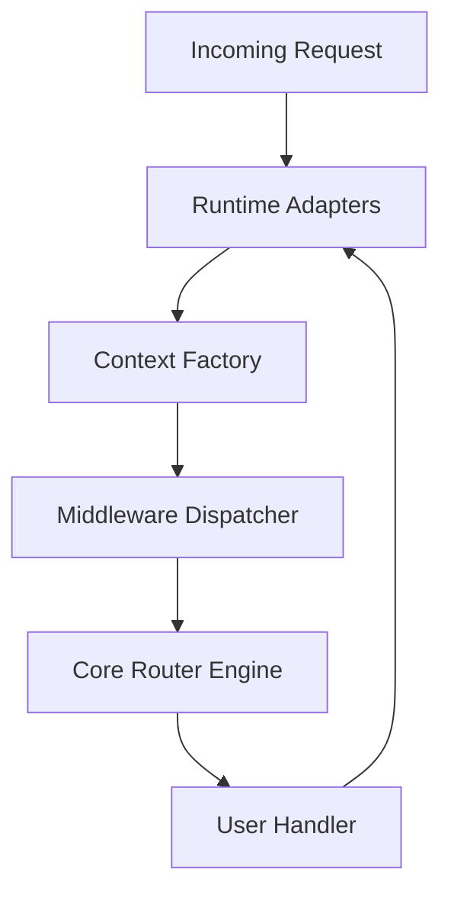

# honojs/hono

> Tiny TypeScript web framework built on Web Standards, running on every JavaScript runtime.

## The problem
The same web API code is often rewritten for each target: Workers, Deno, Bun, Lambda or Node.js.

## What it actually does
Router (RegExpRouter, SmartRouter, TrieRouter, etc.), built-in middlewares, JSX rendering and HTTP client, with no external dependency. Adapters translate each platform's request into a common context, then the response in the opposite direction. The `hono/tiny` preset weighs under 12 kB according to the README.

## How it is wired



## Trying it
```bash
npm create hono@latest
```

## Cost and gotchas
Free. Node.js is not required by the README (multi-runtime), but installation goes through npm. Not all third-party middlewares are maintained by the project.

## What it is not
Not a full-stack framework with a database or ORM. The announced performance comes from the README and the benchmarks repository, not from a measurement of mine. No data or AI feature.

## Alternatives
No alternative named in the README.

## For you
Worth watching: useful to expose a small API or a lightweight inference endpoint at the edge, of no direct interest for training or heavy MLOps.
