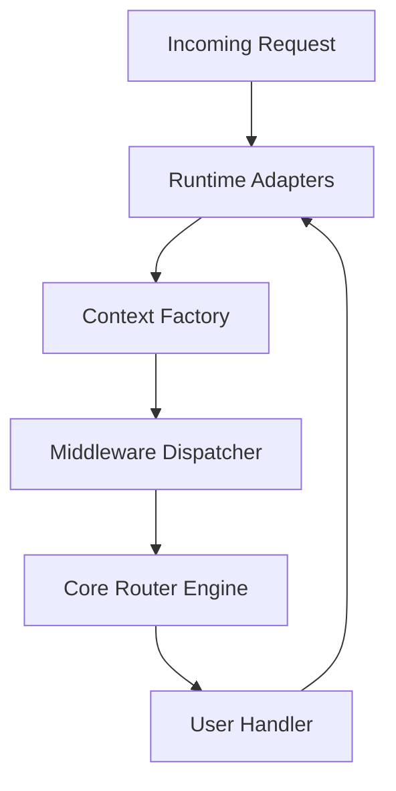

# honojs/hono

> Framework web TypeScript minuscule, bâti sur les Web Standards, qui tourne sur tous les runtimes JavaScript.

## Le problème
Un même code d'API web est souvent réécrit selon la cible : Workers, Deno, Bun, Lambda ou Node.js.

## Ce que ça fait vraiment
Routeur (RegExpRouter, SmartRouter, TrieRouter, etc.), middlewares intégrés, rendu JSX et client HTTP, sans dépendance externe. Des adaptateurs traduisent la requête de chaque plateforme vers un contexte commun, puis la réponse en sens inverse. Le préréglage `hono/tiny` pèse moins de 12 ko d'après le README.

## Comment c'est branché



## Essayer
```bash
npm create hono@latest
```

## Coût et pièges
Gratuit. Node.js n'est pas imposé par le README (multi-runtime), mais l'installation passe par npm. Les middlewares tiers ne sont pas tous maintenus par le projet.

## Ce que ce n'est pas
Ce n'est pas un framework full-stack avec base de données ni ORM. Les performances annoncées viennent du README et du dépôt de benchmarks, pas d'une mesure de ma part. Pas de fonctionnalité data ou IA.

## Alternatives
Aucune alternative nommée dans le README.

## Pour toi
À surveiller : utile pour exposer une petite API ou un endpoint d'inférence léger en edge, sans intérêt direct pour l'entraînement ou le MLOps lourd.

