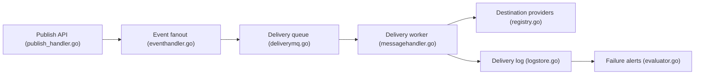

# hookdeck/outpost

> Self-hostable infrastructure for sending webhooks and events to your customers' systems.

## The problem
Adding outbound webhooks to a SaaS platform means handling retries, per-customer isolation, signatures and failure tracking. Homegrown systems quickly become a burden.

## What it actually does
Receives events via API or queue and fans them out by topic to destinations (webhook, EventBridge, SQS, S3, Pub/Sub, RabbitMQ, Kafka), with at-least-once delivery, manual and automatic retries, failure alerts and a customer portal. Depends on Redis, PostgreSQL and a message queue. Go, Python and TypeScript SDKs and an MCP server.

## How it is wired


## Trying it
```bash
git clone https://github.com/hookdeck/outpost.git
cd outpost/examples/docker-compose/
cp .env.example .env
docker-compose -f compose.yml -f compose-rabbitmq.yml -f compose-postgres.yml up
curl -X PUT "$OUTPOST_URL/api/v1/tenants/acme-corp" -H "Authorization: Bearer $API_KEY"
```

## Cost and gotchas
Free when self-hosted, but you must operate Redis, PostgreSQL and a queue. Paid managed version (from $10 per million events).

## What it is not
Not an inbound webhook tool or an internal event bus. It targets platform vendors who notify their customers.

## Alternatives
Managed Hookdeck Outpost version (same code, no operations).

## For you
Worth watching: useful if your AI platform must notify external customers; without that need, useless to a data profile.
