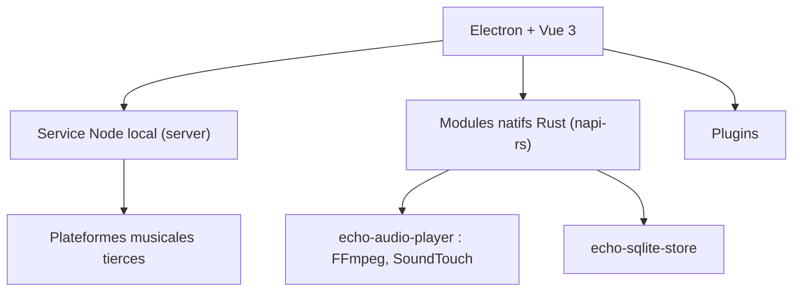

# hoowhoami/EchoMusic

> Third-party desktop music player (Electron, Vue, Rust) for listening to Chinese platforms.

## The problem
The official clients of music platforms are heavy; this project offers a single, clean and extensible interface.

## What it actually does
A desktop player with recommendations, search, playlist import, synchronised lyrics, a 10-band equaliser, LUFS normalisation, real-time spectrum and plugins. It casts to DLNA and AirPlay and integrates with the system media controls. The audio engine is written in Rust (napi-rs) across eight native modules.

## How it is wired
Simplified diagram based on the fiche, no diagram provided.



## Trying it
```bash
git clone https://github.com/hoowhoami/EchoMusic.git
cd EchoMusic
git submodule update --init --recursive
pnpm install
pnpm dev
```
The native modules must be built first (`npm install` then `npm run build` in each `native/<module>`).

## Cost and gotchas
Free, but the build chain is heavy: Node 22.12+, pnpm 9+, stable Rust, LLVM/libclang. Plugins are not sandboxed: only install them from trusted sources.

## What it is not
Not a streaming service: no audio is hosted. Access relies on third-party platforms' public APIs, and the README specifies use limited to personal study. README in Chinese.

## Alternatives
- SPlayer: project cited as inspiration, a simple player.
- MoeKoeMusic: open source client for the KuGou platform, cited as inspiration.

## For you
Ignore: consumer application unrelated to data, AI or MLOps work, and its use of third-party platform APIs remains fragile.
