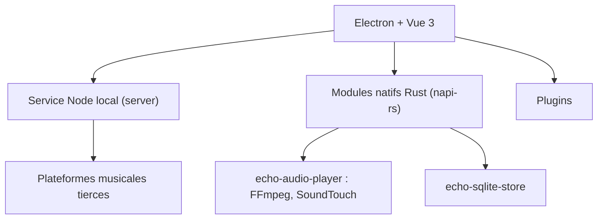

# hoowhoami/EchoMusic

> Lecteur de musique de bureau tiers (Electron, Vue, Rust) pour écouter des plateformes chinoises.

## Le problème
Les clients officiels des plateformes de musique sont lourds ; ce projet propose une interface unique, sobre et extensible.

## Ce que ça fait vraiment
Un lecteur de bureau avec recommandations, recherche, import de listes de lecture, paroles synchronisées, égaliseur 10 bandes, normalisation LUFS, spectre en temps réel et plugins. Il envoie vers DLNA et AirPlay et s'intègre aux commandes média du système. Le moteur audio est écrit en Rust (napi-rs) dans huit modules natifs.

## Comment c'est branché
Schéma simplifié d'après la fiche, sans diagramme fourni.



## Essayer
```bash
git clone https://github.com/hoowhoami/EchoMusic.git
cd EchoMusic
git submodule update --init --recursive
pnpm install
pnpm dev
```
Il faut d'abord compiler les modules natifs (`npm install` puis `npm run build` dans chaque `native/<module>`).

## Coût et pièges
Gratuit, mais la chaîne de build est lourde : Node 22.12+, pnpm 9+, Rust stable, LLVM/libclang. Les plugins ne sont pas isolés : ne les installer que de sources fiables.

## Ce que ce n'est pas
Pas un service de streaming : aucun audio n'est hébergé. L'accès s'appuie sur des API publiques de plateformes tierces, et le README précise un usage limité à l'étude personnelle. README en chinois.

## Alternatives
- SPlayer : projet cité en inspiration, lecteur simple.
- MoeKoeMusic : client open source pour la plateforme KuGou, cité en inspiration.

## Pour toi
À ignorer : application grand public sans rapport avec un travail data, IA ou MLOps, et son usage des API de plateformes tierces reste fragile.

