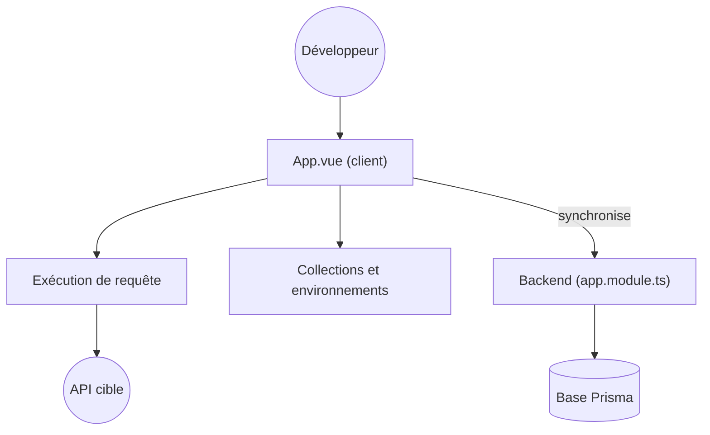

# hoppscotch/hoppscotch

> Open-source API client, in the browser or as a desktop app, for testing REST, GraphQL and real-time streams.

## The problem
Testing an API by hand with curl quickly becomes unreadable. Heavy clients require an account and an installation.

## What it actually does
Web interface (PWA) for composing REST and GraphQL requests, with authentication, headers, body, environment variables, pre- and post-request scripts, collections and history. It also handles WebSocket, Server-Sent Events, Socket.IO and MQTT. A backend provides teams, workspaces and synchronization; a proxy works around CORS.

## How it is wired

## Trying it
No documented command: the README points to hoppscotch.io and to the self-hosting documentation. Usage comes down to three steps: enter the URL, click Send, read the response.

## Cost and gotchas
Free for basic use; SSO and enterprise features belong to a paid edition. The official proxy is hosted by Hoppscotch (read the privacy policy).

## What it is not
Not a load-testing or API contract-testing tool: it is an interactive client. Team features require the backend or the cloud.

## Alternatives
No alternative named in the README.

## For you
Adopt it to query your model APIs and inference services without a heavy installation, while keeping the option to self-host it.
