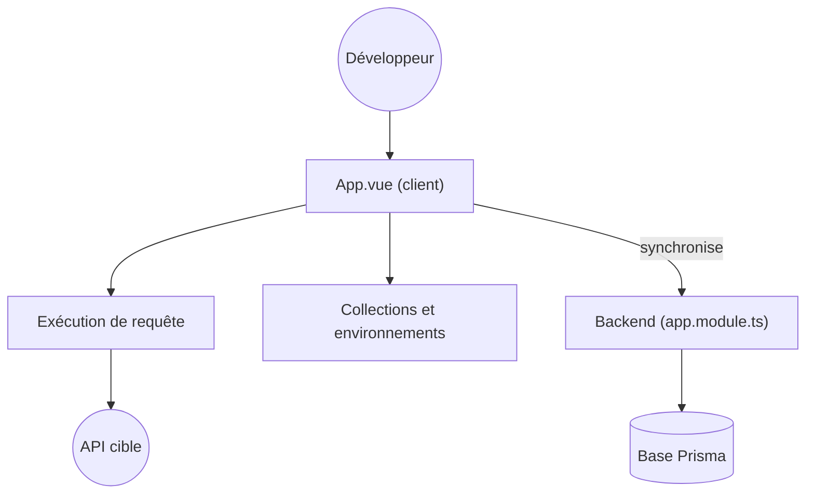

# hoppscotch/hoppscotch

> Client d'API open source, dans le navigateur ou en application de bureau, pour tester REST, GraphQL et flux temps réel.

## Le problème
Tester une API à la main avec curl devient vite illisible. Les clients lourds imposent compte et installation.

## Ce que ça fait vraiment
Interface web (PWA) pour composer des requêtes REST et GraphQL, avec authentification, en-têtes, corps, variables d'environnement, scripts avant et après requête, collections et historique. Gère aussi WebSocket, Server-Sent Events, Socket.IO et MQTT. Un backend permet équipes, espaces de travail et synchronisation ; un proxy contourne CORS.

## Comment c'est branché

## Essayer
Aucune commande documentée : le README renvoie à hoppscotch.io et à la documentation d'auto-hébergement. L'usage tient en trois étapes : saisir l'URL, cliquer sur Envoyer, lire la réponse.

## Coût et pièges
Gratuit en usage de base ; SSO et fonctions d'entreprise relèvent d'une édition payante. Le proxy officiel est hébergé par Hoppscotch (politique de confidentialité à lire).

## Ce que ce n'est pas
Pas un outil de test de charge ni de contrat d'API : c'est un client interactif. Les fonctions d'équipe demandent le backend ou le cloud.

## Alternatives
Aucune alternative nommée dans le README.

## Pour toi
À adopter pour interroger tes API de modèles et services d'inférence sans installation lourde, en gardant l'option de l'auto-héberger.

