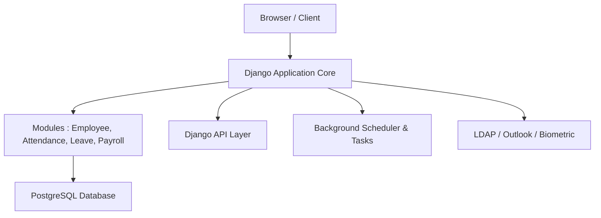

# horilla-opensource/horilla

> Free web application for human resources management, in Django: recruitment, leave, payroll, attendance.

## The problem
Managing employees, attendance, leave and payroll in scattered spreadsheets, or paying for a proprietary HR suite.

## What it actually does
Horilla is a Django monolith split into applications: employees, recruitment, onboarding and offboarding, attendance with biometrics, leave, payroll, performance, assets, helpdesk, projects. It adds a token-based REST API for the mobile app, notifications, exportable reports, LDAP, Google Meet, Google Drive and WhatsApp. A scheduler runs deferred tasks (payslips, leave reset).

## How it is wired
Based on the provided diagram, simplified.



## Trying it
```bash
docker pull horilla/horilla-hr:2.3.0
git clone https://github.com/horilla/horilla-hr.git
cd horilla-hr
docker compose up -d
```
Then http://localhost:8000.

## Cost and gotchas
Free, but you must run the scheduler (`run_scheduler`) for tasks to fire. Python 3.12 to 3.14 only. 130 open issues.

## What it is not
Not a data tool: it is a business HR application. The Geofencing, Face Detection and Outlook modules ship but are disabled by default.

## Alternatives
No alternative named in the README.

## For you
Ignore: an HR application unrelated to data / AI / MLOps work, unless you need a self-hosted HR tool.
