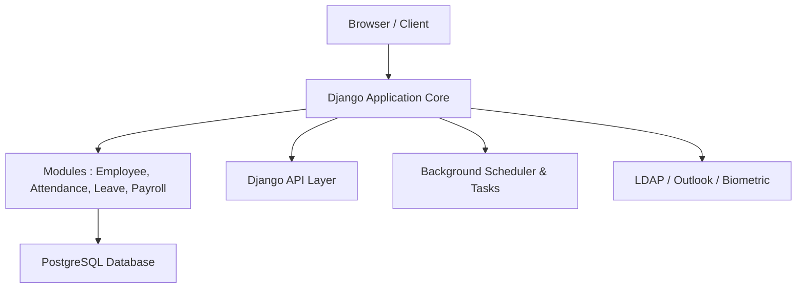

# horilla-opensource/horilla

> Application web libre de gestion des ressources humaines, en Django : recrutement, congés, paie, présence.

## Le problème
Gérer employés, présences, congés et paie dans des tableurs dispersés, ou payer une suite RH propriétaire.

## Ce que ça fait vraiment
Horilla est un monolithe Django découpé en applications : employés, recrutement, intégration et départ, présence avec biométrie, congés, paie, performance, actifs, helpdesk, projets. Il ajoute une API REST à jeton pour l'application mobile, des notifications, des rapports exportables, LDAP, Google Meet, Google Drive et WhatsApp. Un planificateur exécute les tâches différées (fiches de paie, remise à zéro des congés).

## Comment c'est branché
D'après le diagramme fourni, simplifié.



## Essayer
```bash
docker pull horilla/horilla-hr:2.3.0
git clone https://github.com/horilla/horilla-hr.git
cd horilla-hr
docker compose up -d
```
Puis http://localhost:8000.

## Coût et pièges
Gratuit, mais il faut faire tourner le planificateur (`run_scheduler`) pour que les tâches partent. Python 3.12 à 3.14 uniquement. 130 issues ouvertes.

## Ce que ce n'est pas
Pas un outil data : c'est une application métier RH. Les modules Geofencing, Face Detection et Outlook sont livrés mais désactivés par défaut.

## Alternatives
Aucune alternative nommée dans le README.

## Pour toi
À ignorer : application RH sans lien avec le travail data / IA / MLOps, sauf besoin d'un outil RH auto-hébergé.

