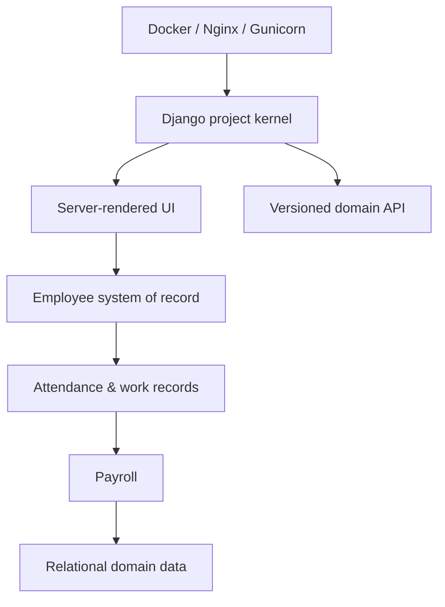

# horilla/horilla-hr

> Free Django web application for HR management, same project as horilla-opensource/horilla (identical README).

## The problem
Managing employees, attendance, leave and payroll without a proprietary HR suite.

## What it actually does
The README is identical to that of horilla-opensource/horilla. A modular Django 5 monolith: employees, recruitment, onboarding and offboarding, attendance, leave, payroll, performance, assets, helpdesk, projects. The architecture described from the code adds a platform kernel with per-company scoping, an API per domain, a reporting engine and integrations (Anviz biometrics, LDAP, Google Drive, WhatsApp).

## How it is wired
Based on the provided diagram, simplified.



## Trying it
```bash
docker pull horilla/horilla-hr:2.3.0
git clone https://github.com/horilla/horilla-hr.git
cd horilla-hr
docker compose up -d
python manage.py run_scheduler
```
The last command applies to a manual installation.

## Cost and gotchas
Free. The scheduler must run separately outside Docker Compose. The README says Python 3.12 to 3.14 while its badge says 3.11 or later.

## What it is not
Not a second project: this name points to the same repository (same dates, same stars). Not a data tool either.

## Alternatives
No alternative named in the README.

## For you
Ignore: a duplicate of horilla-opensource/horilla, and an HR application unrelated to data / AI / MLOps work.
