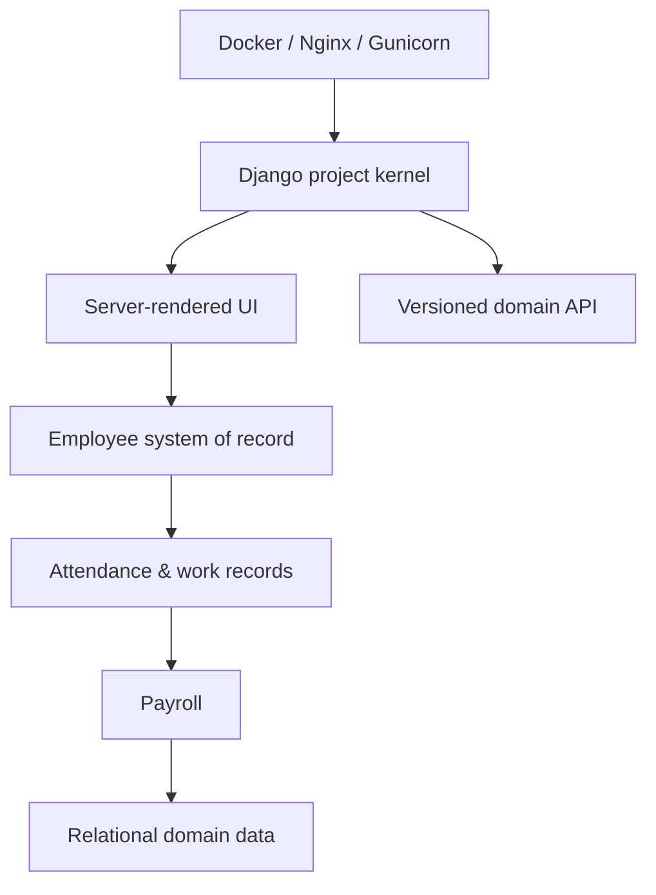

# horilla/horilla-hr

> Application web libre de gestion RH en Django, même projet que horilla-opensource/horilla (README identique).

## Le problème
Gérer employés, présences, congés et paie sans suite RH propriétaire.

## Ce que ça fait vraiment
Le README est identique à celui de horilla-opensource/horilla. Monolithe Django 5 modulaire : employés, recrutement, intégration et départ, présence, congés, paie, performance, actifs, helpdesk, projets. L'architecture décrite d'après le code ajoute un noyau de plateforme avec périmètre par société, une API par domaine, un moteur de rapports et des intégrations (biométrie Anviz, LDAP, Google Drive, WhatsApp).

## Comment c'est branché
D'après le diagramme fourni, simplifié.



## Essayer
```bash
docker pull horilla/horilla-hr:2.3.0
git clone https://github.com/horilla/horilla-hr.git
cd horilla-hr
docker compose up -d
python manage.py run_scheduler
```
La dernière commande vaut pour une installation manuelle.

## Coût et pièges
Gratuit. Le planificateur doit tourner séparément hors Docker Compose. Le README dit Python 3.12 à 3.14 alors que son badge dit 3.11 ou plus.

## Ce que ce n'est pas
Pas un second projet : ce nom pointe vers le même dépôt (mêmes dates, mêmes étoiles). Pas non plus un outil data.

## Alternatives
Aucune alternative nommée dans le README.

## Pour toi
À ignorer : doublon de horilla-opensource/horilla, et application RH sans rapport avec le travail data / IA / MLOps.

