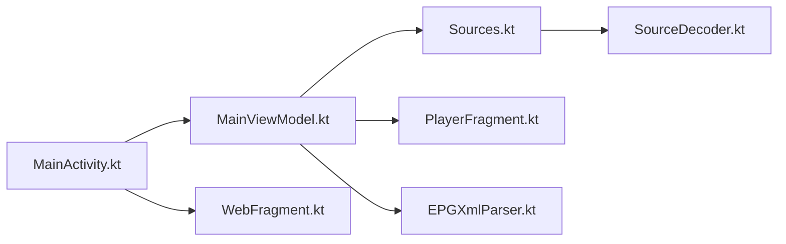

# horsemail/yourtv

> Android app for live IPTV television and web video, with customizable sources, for TVs and phones.

## The problem
Watching IPTV streams or video pages on an Android TV requires an app that accepts lists of personal sources.

## What it actually does
An Android app (6.0 minimum) that reads channel sources, shows the program guide (EPG), plays streams in an IPTV player or a WebView (Tencent's X5), and accepts encrypted custom sources. It handles picture-in-picture and screen-off playback. It merges the features of my-tv, mytv-android and WebViewTVLive.

## How it is wired


## Trying it
```bash
adb install YourTV.apk
```

## Cost and gotchas
Free. The published APK differs from the code: the README says the source lags a few days behind and that the APK's encryption is not the one in the repository, to protect its private sources.

## What it is not
Not a content provider: you bring the sources. The README does not document the legality of the streams; short README, in Traditional Chinese.

## Alternatives
The README thanks `live`, `my-tv-0` and `my-tv-1`, whose features the project takes over.

## For you
Ignore: outside the data/AI profile, and the APK not being reproducible from the sources makes it untrustworthy.
