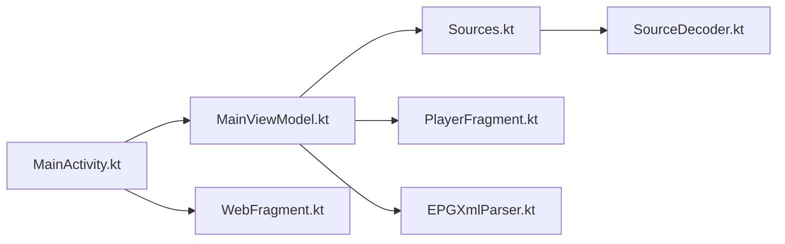

# horsemail/yourtv

> Application Android de télévision en direct IPTV et vidéo web, avec sources personnalisables, pour téléviseurs et téléphones.

## Le problème
Regarder des flux IPTV ou des pages vidéo sur un téléviseur Android demande une application qui accepte des listes de sources personnelles.

## Ce que ça fait vraiment
Une app Android (6.0 minimum) qui lit des sources de chaînes, affiche le guide des programmes (EPG), joue les flux dans un lecteur IPTV ou un WebView (X5 de Tencent), et accepte des sources personnalisées chiffrées. Elle gère l'image dans l'image et la lecture écran éteint. Elle fusionne les fonctions de my-tv, mytv-android et WebViewTVLive.

## Comment c'est branché


## Essayer
```bash
adb install YourTV.apk
```

## Coût et pièges
Gratuit. L'APK publié diffère du code : le README dit que la source accuse quelques jours de retard et que le chiffrement de l'APK n'est pas celui du dépôt, pour protéger ses sources privées.

## Ce que ce n'est pas
Pas un fournisseur de contenu : tu apportes les sources. Le README ne documente pas la légalité des flux ; README court et en chinois traditionnel.

## Alternatives
Le README remercie `live`, `my-tv-0` et `my-tv-1` dont le projet reprend les fonctions.

## Pour toi
À ignorer : hors profil data/IA, et l'APK non reproductible depuis les sources empêche de lui faire confiance.

