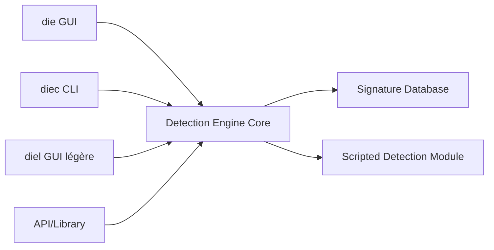

# horsicq/Detect-It-Easy

> Cross-platform file identification and static inspection tool, for malware analysts and reverse engineers.

## The problem
Before analyzing an executable, you need to know what produced it, whether it is packed or protected, and whether it is damaged. Without a dedicated tool, this triage is manual.

## What it actually does
A native core analyzes file formats; a signature database written in DiE-JS (JavaScript) is added on top, with a heuristic engine for PE executables. The file is never run. Heuristic results are marked `(Heur)`. It also integrates NFD, YARA and PEiD. It comes as a graphical interface (die), a command line (diec) and a lightweight GUI version (diel).

## How it is wired


## Trying it
```bash
git clone --recursive https://github.com/horsicq/Detect-It-Easy
cd Detect-It-Easy/
docker build . -t horsicq:diec
```
Documented option: `--heuristicscan` with `--verbose` for the most complete report.

## Cost and gotchas
Free, MIT license. Fake sites imitate the project (detectiteasy.com is not affiliated): download only from the repository's releases. Handling malware samples requires an isolated environment.

## What it is not
It is not an antivirus: no real-time protection, and an empty report does not prove a file is clean. A heuristic result is a lead, not proof. PEiD signatures are noisy.

## Alternatives
- Nauz File Detector: independent second opinion, database updated less often.
- YARA: text and binary rules, the standard among malware researchers.
- PEiD: historical detector, for reproducing old detections.

## For you
Worth watching: useful in supply chain security for inspecting a suspicious binary, but outside the core of data / AI work.
