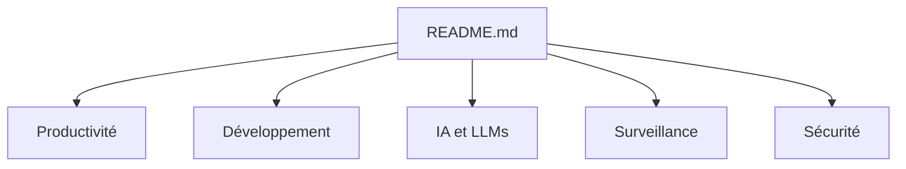

# hotheadhacker/awesome-selfhost-docker

> List of free self-hostable software, deployable with Docker and docker-compose.

## The problem
Choosing a free equivalent to a SaaS service means digging through dozens of catalogs.

## What it actually does
Tables by category (Productivity, Development, AI and LLM, Automation, Media, Security, Network, Monitoring, Backup, Analytics, etc.), each row giving a name and a one-sentence description. The AI category cites Ollama, vLLM, LocalAI, LibreChat, RAGFlow and AnythingLLM. The README provided is cut off in the middle of the Analytics table.

## How it is wired
Simplified diagram based on the sheet, no diagram provided.

## Trying it
No command documented: the links lead to the listed projects.

## Cost and gotchas
Free. Each listed project has its own license, maintenance load and resources.

## What it is not
It is not a deployment guide: it gives neither a compose file nor security settings. No license is declared.

## Alternatives
No alternative named in the README.

## For you
Watch: serves as a catalog for building a home lab (Ollama, Grafana, Airflow, Metabase), with no value beyond an index.
