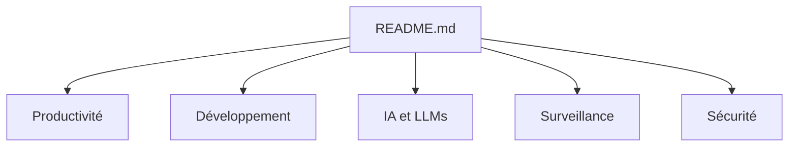

# hotheadhacker/awesome-selfhost-docker

> Liste de logiciels libres auto-hébergeables, déployables avec Docker et docker-compose.

## Le problème
Choisir un équivalent libre à un service SaaS demande de fouiller des dizaines de catalogues.

## Ce que ça fait vraiment
Tableaux par catégorie (Productivité, Développement, IA et LLM, Automatisation, Médias, Sécurité, Réseau, Surveillance, Sauvegarde, Analytique, etc.), chaque ligne donnant un nom et une description d'une phrase. La catégorie IA cite Ollama, vLLM, LocalAI, LibreChat, RAGFlow et AnythingLLM. Le README fourni est coupé en cours de tableau Analytique.

## Comment c'est branché
Schéma simplifié d'après la fiche, sans diagramme fourni.

## Essayer
Aucune commande documentée : les liens mènent aux projets listés.

## Coût et pièges
Gratuit. Chaque projet listé a sa propre licence, sa charge de maintenance et ses ressources.

## Ce que ce n'est pas
Ce n'est pas un guide de déploiement : il n'indique ni fichier compose ni réglage de sécurité. Aucune licence n'est déclarée.

## Alternatives
Aucune alternative nommée dans le README.

## Pour toi
Surveiller : sert de catalogue pour monter un laboratoire maison (Ollama, Grafana, Airflow, Metabase), sans valeur au-delà d'un index.

