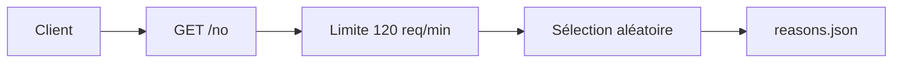

# hotheadhacker/no-as-a-service

> Small Express API that randomly returns an excuse for saying no, for fun.

## The problem
Sometimes a polite or funny way to refuse is missing in a bot or a page.

## What it actually does
`GET /no` returns a JSON `{ "reason": ... }` picked at random from a `reasons.json` file (over 1000 entries). Limit of 120 requests/minute/IP via express-rate-limit. Hosted public instance, or self-hosting.

## How it is wired


## Trying it
```bash
git clone https://github.com/hotheadhacker/no-as-a-service.git
cd no-as-a-service
npm install
npm start
PORT=5000 npm start
```

## Cost and gotchas
Free. The README mentions GitAds sponsorship and a public instance (naas.isalman.dev) whose availability is not guaranteed.

## What it is not
Not an AI: a random draw from a static list.

## Alternatives
No alternative named in the README (Rust, ASP, etc. ports are listed as user projects).

## For you
Ignore: a tech joke, no value for a data/AI/MLOps profile.
