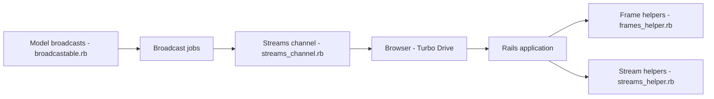

# hotwired/turbo-rails

> Gem that integrates Turbo (navigation, frames, streams) into Rails for reactive pages without writing JavaScript.

## The problem
Getting the fluidity of a single-page application requires writing a lot of JavaScript and a dedicated JSON API.

## What it actually does
Turbo Drive intercepts links and forms to replace the `<body>` via `fetch`. Turbo Frames splits a page into replaceable or lazily loaded components. Turbo Streams pushes HTML fragments over Action Cable after model changes. The gem adds the Rails helpers (`turbo_frame_tag`, `turbo_stream_from`), test assertions and native navigation for hybrid apps.

## How it is wired


## Trying it
```bash
./bin/bundle install
./bin/rails turbo:install
./bin/test
```
(Rails 7+ installs it by default.)

## Cost and gotchas
Free. In development, the `async` Action Cable adapter only broadcasts within the same process: a separate console will not trigger any browser display.

## What it is not
Not a framework independent of Rails (it is the bridge), nor a replacement for Stimulus for the remaining JS logic. Last push in July 2026.

## Alternatives
Rails UJS (compatibility described); Stimulus for the remaining JavaScript.

## For you
Ignore: Rails front end, unrelated to data/AI; worth remembering only if you build an internal dashboard in Rails.
