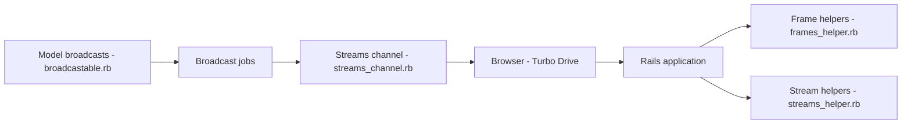

# hotwired/turbo-rails

> Gem qui intègre Turbo (navigation, frames, streams) à Rails pour des pages réactives sans écrire de JavaScript.

## Le problème
Obtenir la fluidité d'une application monopage oblige à écrire beaucoup de JavaScript et une API JSON dédiée.

## Ce que ça fait vraiment
Turbo Drive intercepte liens et formulaires pour remplacer le `<body>` via `fetch`. Turbo Frames découpe une page en composants remplaçables ou chargés à la demande. Turbo Streams pousse des fragments HTML par Action Cable après des changements de modèle. La gem ajoute les helpers Rails (`turbo_frame_tag`, `turbo_stream_from`), des assertions de test et une navigation native pour apps hybrides.

## Comment c'est branché


## Essayer
```bash
./bin/bundle install
./bin/rails turbo:install
./bin/test
```
(Rails 7+ l'installe par défaut.)

## Coût et pièges
Gratuit. En développement, l'adaptateur Action Cable `async` ne diffuse qu'au sein du même processus : une console séparée ne déclenchera pas d'affichage navigateur.

## Ce que ce n'est pas
Pas un framework indépendant de Rails (c'est le pont), ni un remplaçant de Stimulus pour la logique JS restante. Dernier push en juillet 2026.

## Alternatives
Rails UJS (compatibilité décrite) ; Stimulus pour le JavaScript restant.

## Pour toi
Ignorer : front Rails, sans lien avec data/IA ; à retenir seulement si tu bâtis un tableau de bord interne en Rails.

