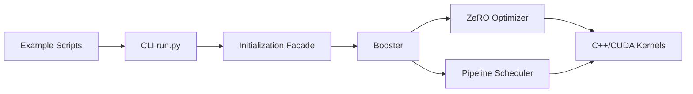

# hpcaitech/ColossalAI

> PyTorch library for distributed training and inference of large models, for GPU teams.

## The problem
Training a model with several billion parameters requires combining parallelisms and memory optimizations by hand.

## What it actually does
Data, pipeline, tensor (1D to 3D) and sequence parallelism; ZeRO; auto-parallelism; heterogeneous memory offload. A `Booster` wraps the PyTorch model; the `colossalai run` CLI launches the processes. CUDA/Triton kernels compiled on demand. Bundled applications: ColossalChat (RLHF), Colossal-LLaMA, Colossal-Inference.

## How it is wired


## Trying it
```bash
pip install colossalai
BUILD_EXT=1 pip install colossalai
docker build -t colossalai ./docker
docker run -ti --gpus all --rm --ipc=host colossalai bash
```

## Cost and gotchas
NVIDIA GPU (compute capability ≥ 7.0), CUDA ≥ 11, Linux only. The README strongly pushes the vendor's paid cloud (HPC-AI).

## What it is not
Not useful on a single small GPU for everyday fine-tuning. The speedup figures are the vendor's own.

## Alternatives
None named as a competitor (vLLM appears only as a comparison reference).

## For you
Worth watching if you train beyond a single node; otherwise too heavy.
