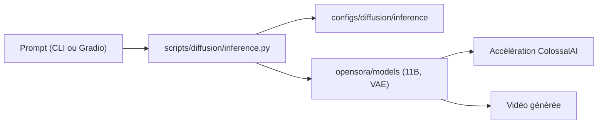

# hpcaitech/Open-Sora

> Open model for video generation from text or image, with inference and training code.

## The problem
High-performing video generation models are closed, and their weights, data and training recipes remain inaccessible.

## What it actually does
Publishes an 11-billion-parameter model (256 px and 768 px) for text-to-video and image-to-video, with command-line inference via torchrun. The text, image (Flux), video pipeline is offered. From the code: diffusion and VAE scripts, configurations, the opensora package (ColossalAI acceleration, models, datasets) and a Gradio demo. The README quantifies generation time: 60 s and 52.5 GB of GPU memory at 256 px on one GPU.

## How it is wired


## Trying it
```bash
conda create -n opensora python=3.10
conda activate opensora
git clone https://github.com/hpcaitech/Open-Sora
cd Open-Sora
pip install -v .
huggingface-cli download hpcai-tech/Open-Sora-v2 --local-dir ./ckpts
torchrun --nproc_per_node 1 --standalone scripts/diffusion/inference.py configs/diffusion/inference/t2i2v_256px.py --save-dir samples --prompt "raining, sea"
```

## Cost and gotchas
H100/H800-class GPU (52 to 60 GB of memory stated), several GPUs for 768 px (1,656 s on one GPU). xformers and flash-attn installation depends on your CUDA version. Prompt refinement via ChatGPT requires an optional OpenAI key.

## What it is not
Not equivalent to OpenAI's Sora: the README only claims a reduced gap on VBench. The repository also promotes a commercial product (Video Ocean).

## Alternatives
- HunyuanVideo (11B): compared with the model in the README.
- Step-Video (30B): another reference in the comparison.

## For you
To watch: interesting for understanding distributed video training and inference, but requires GPUs that few teams have.
