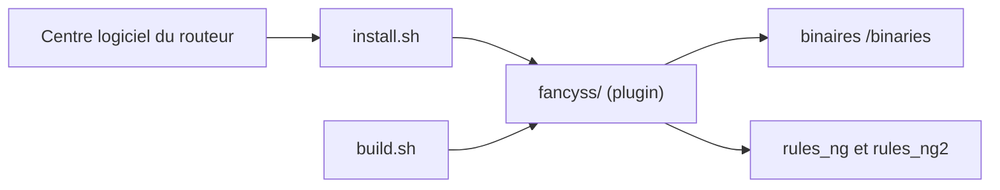

# hq450/fancyss

> Transparent proxy plugin for ASUS Merlin/stock routers, designed to bypass network filtering.

## The problem
Route the traffic of an entire home network through a proxy without configuring each device.

## What it actually does
Installs from the router's software center and offers several protocols (SS, SSR, VMess, VLESS, Trojan, Hysteria2, NaïveProxy, TUIC). It manages nodes (import, subscription), DNS splitting (`chinadns-ng` or `smartdns`), list-based rules, latency testing and simple failover. Seven packages per platform (`arm`, `hnd`, `hnd_v8`, `qca`, `mtk`, `ipq32`, `ipq64`), in `full` or `lite` variants.

## How it is wired


## Trying it
```bash
mv /tmp/fancyss_hnd_lite.tar.gz /tmp/shadowsocks.tar.gz
tar -zxvf /tmp/shadowsocks.tar.gz
sh /tmp/shadowsocks/install.sh
```

## Cost and gotchas
The plugin is free, but you need a compatible router and third-party proxy nodes (the README advertises paid providers). Pick the right package for your platform, otherwise the installation fails.

## What it is not
Not a turnkey VPN. Works only on the announced list of ASUS models. No support for other routers.

## Alternatives
None cited in the README.

## For you
Ignore: it depends on specific ASUS hardware and third-party proxy services, unrelated to your data/AI/MLOps work.
