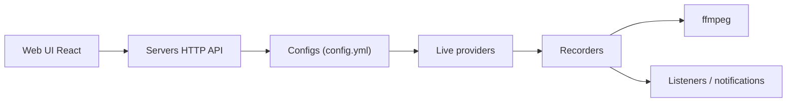

# hr3lxphr6j/bililive-go

> Live stream recording tool for many Chinese and Japanese platforms, with a web interface.

## The problem
Automatically recording live streams when they start, without watching the platforms by hand.

## What it actually does
A Go service monitors rooms (Bilibili, Douyu, Huya, Douyin, SOOP, etc.), launches recording via ffmpeg and writes the files to a folder. React web interface for settings and playback of recordings, per-domain cookies, Telegram and ntfy notifications, optional Prometheus and Grafana dashboard.

## How it is wired


## Trying it
```bash
docker run --restart=always -v ~/config.yml:/etc/bililive-go/config.yml -v ~/Videos:/srv/bililive -p 8080:8080 -d chigusa/bililive-go
docker compose up
```

## Cost and gotchas
Free. Depends on ffmpeg. The README warns that third-party code in the ecosystem is not audited. README in Chinese. Cookies must be obtained yourself for each site.

## What it is not
Not a player nor an archiving service: it records streams. Rights over the recorded content are not addressed in the README.

## Alternatives
you-get, ykdl, youtube-dl: cited as references; to be preferred for one-off downloads rather than continuous monitoring.

## For you
Ignore: unrelated to data or AI, and focused on specific streaming platforms.
