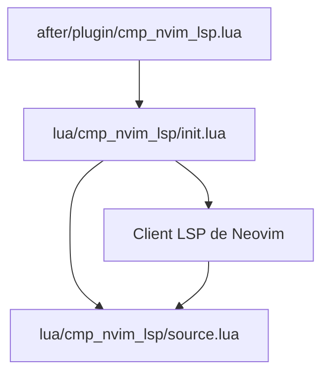

# hrsh7th/cmp-nvim-lsp

> nvim-cmp completion source that taps into Neovim's built-in language server client.

## The problem
nvim-cmp cannot read the results of Neovim's LSP client without a dedicated bridge.

## What it actually does
Registers an nvim_lsp source in nvim-cmp, provides via default_capabilities the capabilities to announce to language servers, and converts their responses into completion candidates. You can override keyword_pattern for a given server.

## How it is wired


## Trying it
```lua
require'cmp'.setup {
  sources = { { name = 'nvim_lsp' } }
}
local capabilities = require('cmp_nvim_lsp').default_capabilities()
require('lspconfig').clangd.setup { capabilities = capabilities }
```

## Cost and gotchas
Free. Adding these capabilities breaks Neovim's built-in omnifunc. Hobby project: bug reports without a minimal reproducible configuration are not guaranteed to be handled.

## What it is not
Not a completion engine: you need nvim-cmp and a language server.

## Alternatives
No alternative named in the README.

## For you
Ignore unless you code in Neovim with nvim-cmp: then it is the standard wiring for LSP autocompletion.
