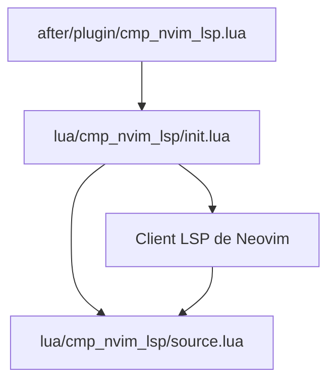

# hrsh7th/cmp-nvim-lsp

> Source de complétion nvim-cmp qui exploite le client de serveur de langage intégré à Neovim.

## Le problème
nvim-cmp ne sait pas lire les résultats du client LSP de Neovim sans un pont dédié.

## Ce que ça fait vraiment
Enregistre une source nvim_lsp dans nvim-cmp, fournit via default_capabilities les capacités à annoncer aux serveurs de langage, et convertit leurs réponses en candidats de complétion. On peut surcharger keyword_pattern pour un serveur donné.

## Comment c'est branché


## Essayer
```lua
require'cmp'.setup {
  sources = { { name = 'nvim_lsp' } }
}
local capabilities = require('cmp_nvim_lsp').default_capabilities()
require('lspconfig').clangd.setup { capabilities = capabilities }
```

## Coût et pièges
Gratuit. Ajouter ces capacités casse l'omnifunc intégré de Neovim. Projet de loisir : les rapports de bug sans configuration minimale reproductible ne sont pas garantis d'être traités.

## Ce que ce n'est pas
Pas un moteur de complétion : il faut nvim-cmp et un serveur de langage.

## Alternatives
Aucune alternative nommée dans le README.

## Pour toi
Ignorer sauf si tu codes sous Neovim avec nvim-cmp : alors c'est le branchement standard pour l'autocomplétion LSP.

