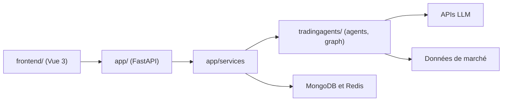

# hsliping/TradingAgents-CN

> Chinese multi-agent LLM stock-analysis platform, derived from TradingAgents, for study purposes.

## The problem
Analysing A/H/US stocks with several LLM agents requires wiring together market data, models, task queues and a user interface, in Chinese.

## What it actually does
Based on the code: a FastAPI backend (app/), a Vue 3 front end and a shared engine tradingagents/ (agents, analysis graph, data flows, LLM clients). It stores everything in MongoDB, Redis handles progress tracking and rate limiting, and reports go out as Markdown, Word or PDF. Data comes from Tushare, AkShare and BaoStock, models from several providers.

## How it is wired

## Trying it
No install command in the README: it points to a Docker guide and a local installation guide.

## Cost and gotchas
LLM models are at your expense and data must be synchronised before analysis, otherwise results are wrong. Mixed licence: Apache 2.0 except app/ and frontend/, which are proprietary and need authorisation for commercial use. The README announces that v2 and v3 are not yet open.

## What it is not
Not a trading tool: the README rules out real orders and investment advice. Nor is it the original project (Tauric Research).

## Alternatives
- TauricResearch/TradingAgents: source project cited in the README.

## For you
Ignore: the app and frontend parts are proprietary and the project depends on a single author; start from the upstream project to explore financial agents.
