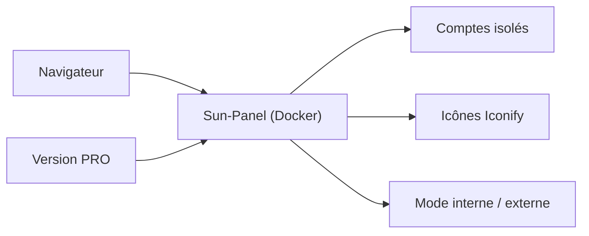

# hslr-s/sun-panel

> Navigation dashboard for a server or NAS, deployable in Docker, now closed source.

## The problem
Finding in one place the links to your self-hosted services, on the internal or external network.

## What it actually does
Configurable home page with icons (Iconify library), switching between internal and external network, isolated multi-accounts, system status, custom JS/CSS, small embedded windows. No external database. The README says that, to fund the project, `PRO` features were added and that the code is temporarily closed; the latest open version is v1.3.0.

## How it is wired

## Trying it
No command in the README: it points to an external deployment tutorial.

## Cost and gotchas
The base version is free, PRO features are paid. The current code is not public: only the code up to v1.3.0 is, making a security audit of the recent version impossible.

## What it is not
No longer really an open project. Reopening is promised but conditional on a PRO/main separation.

## Alternatives
None cited in the README.

## For you
Ignore: closed source on the current version, and a simple links page; no value for a data/AI/MLOps profile.
