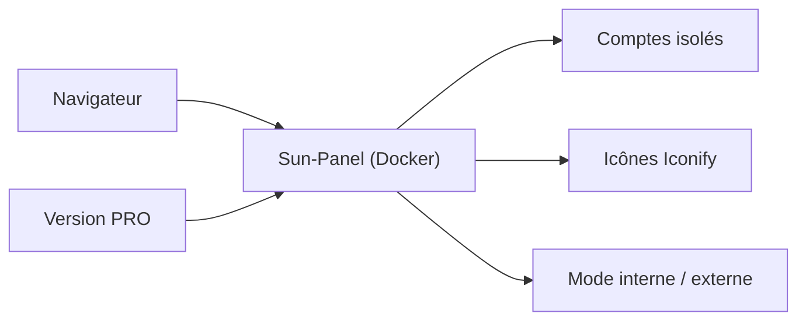

# hslr-s/sun-panel

> Tableau de bord de navigation pour serveur ou NAS, déployable en Docker, passé en source fermée.

## Le problème
Retrouver en un endroit les liens vers ses services auto-hébergés, en réseau interne ou externe.

## Ce que ça fait vraiment
Page d'accueil configurable avec icônes (bibliothèque Iconify), bascule entre réseau interne et externe, multi-comptes isolés, état du système, JS/CSS personnalisés, petites fenêtres intégrées. Sans base de données externe. Le README dit que, pour financer le projet, des fonctions `PRO` ont été ajoutées et que le code est temporairement fermé ; la dernière version ouverte est la v1.3.0.

## Comment c'est branché

## Essayer
Aucune commande dans le README : il renvoie à un tutoriel de déploiement externe.

## Coût et pièges
Version de base gratuite, fonctions PRO payantes. Le code courant n'est pas public : seul le code jusqu'à la v1.3.0 l'est, d'où une audit de sécurité impossible sur la version récente.

## Ce que ce n'est pas
Plus vraiment un projet ouvert. La réouverture est promise mais conditionnée à une séparation PRO/principal.

## Alternatives
Aucune citée dans le README.

## Pour toi
Ignorer : source fermée sur la version actuelle, et simple page de liens ; pas de valeur pour un profil data/IA/MLOps.

